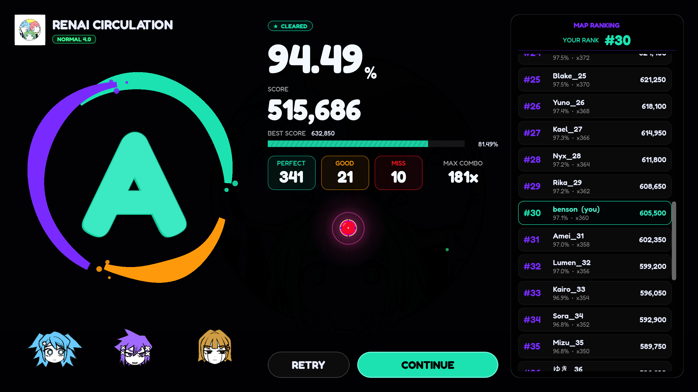
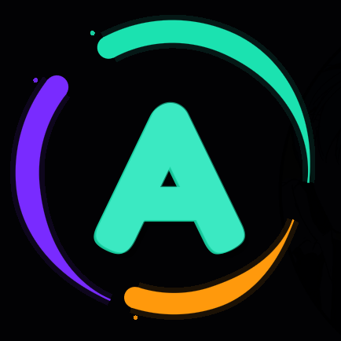
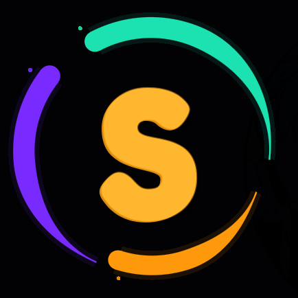
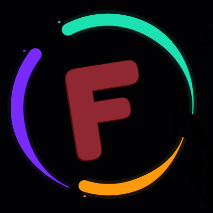
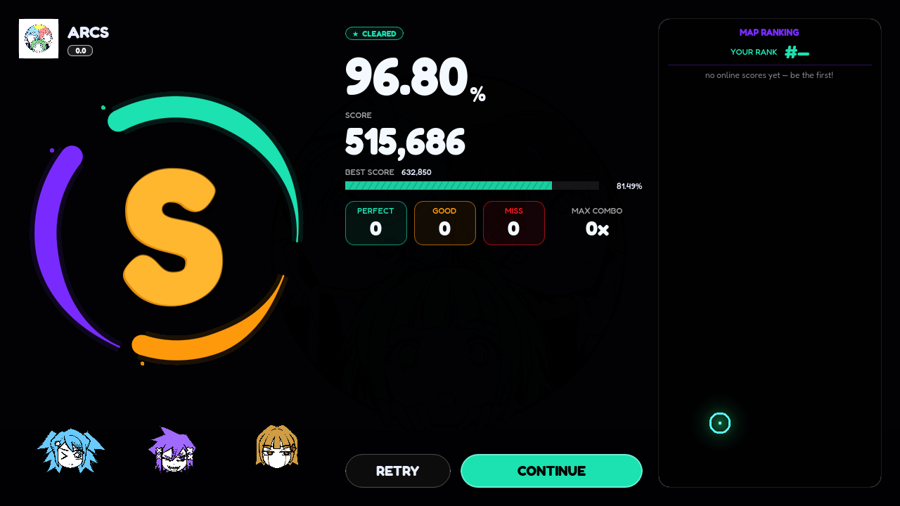

<div align="center">

# 🎵 Meloa — Full Game Source

**The complete Godot source code of Meloa, recovered and released for everyone.**

*Meloa is no longer a closed project. It's ours now — a community project.*

[](https://godotengine.org)
[](#)
[](#-license--disclaimer)
[](#-contributing)
[](#-support-the-project)



</div>

---

## 📖 What is this?

This repository contains the **full source code of Meloa** (internally `Rythm Game` v0.8.16), a rhythm game built in **Godot 4.7**.

The source was recovered — and now it's being handed to the community. No more closed builds, no more black boxes. Everything is here: the gameplay engine, the chart editor, the map pipeline, the online backend client, the UI, the assets, the charts, the music.

> **Meloa is now a community project.** Fork it, mod it, fix it, extend it, self-host it, ship your own versions. The future of this game is written by whoever opens the editor.

<div align="center">
  
</div>

---

## ✨ What's inside

| | |
|---|---|
| 🎮 **Full gameplay engine** — notes, beams, sliders, click targets, multi-notes, HP, combo, scoring, FX | `scripts/main.gd` (~9k lines) |
| ✏️ **Built-in chart editor** — timeline, canvas, inspector, shortcuts | `scripts/editor.gd`, `scripts/editor_ui/` |
| 🌐 **Online client** — auth, profiles, map upload/download, leaderboards, presence, telemetry | `scripts/backend.gd`, `scripts/telemetry.gd` |
| 🗺️ **Map pipeline** — publishing, WIP flags, review flow, zip format, chart hashing | `scripts/map_publisher.gd` |
| 🎵 **21 official tracks** + 30+ charts, both `FLOW` (STANDARD) and `GRID` (MANIA) modes | `tracks/`, `charts/` |
| 🧩 **Mods system** — MIRAGE, SUDDEN DEATH, NO YELLOW, NO WHITE, and more | `scripts/mods.gd` |
| 🎨 **Skins, mascots, UI** — full theming layer | `scripts/skin.gd`, `assets/` |
| 🧪 **Benchmarks & audit tooling** | `bench/` |

---

## 🚀 Quick start

1. **Install [Godot 4.7](https://godotengine.org/download)** (Forward+ renderer).
2. Clone this repo:
   ```bash
   git clone https://github.com/burningstar13/Meloa-Source.git
   cd Meloa-Source
   ```
3. Open the project: `godot --editor project.godot` (or import via the Godot project manager).
4. Hit **F5**. That's it — the game runs fully offline (the online layer just goes idle without a server).

> 💡 The editor cache folder `.godot/` is intentionally **not** committed — Godot regenerates it on first open.

---

## 🤝 Contributing

This is a community project. **Every contribution matters** — code, charts, music, skins, docs, bug reports.

### Fork & PR flow

```bash
# 1. Fork the repo (button top-right on GitHub), then:
git clone https://github.com/<your-name>/Meloa-Source.git
cd Meloa-Source
git checkout -b feature/my-cool-thing

# 2. Make your changes, test in Godot
# 3. Commit & push
git add .
git commit -m "feat: my cool thing"
git push origin feature/my-cool-thing

# 4. Open a Pull Request on GitHub 🎉
```

### Where to make changes

| I want to… | Touch this |
|---|---|
| Tweak gameplay / scoring / note logic | `scripts/main.gd`, `scripts/note.gd`, `scripts/click_target.gd` |
| Add or change a mod | `scripts/mods.gd` (the `CATALOG` array) |
| Improve the chart editor | `scripts/editor.gd`, `scripts/editor_ui/` |
| Change UI / menus / skins | `scripts/settings_menu.gd`, `scripts/skin.gd`, `assets/` |
| Add official charts | `charts/` + `tracks/` (follow the `map.json` zip format in `scripts/map_publisher.gd`) |
| Work on the online layer | `scripts/backend.gd`, `scripts/telemetry.gd` |
| Change settings/autoloads | `project.godot` |

### House rules

- Keep PRs focused — one feature/fix per PR.
- Match the existing GDScript style (tabs, `:=` inference, signal-driven UI).
- Test in Godot 4.7 before submitting.
- No leaked API keys, no malicious code, be excellent to each other.

---

## 🖥️ Running your own server (self-hosting)

The client talks to a REST backend. The official one is gone/offline — but the whole thing is designed to be swappable, so **you can point the game at your own server**.

### How the client picks a backend

Priority order (see `scripts/telemetry.gd`):

1. CLI flag: `--backend-url=https://api.example.com/v1`
2. Environment variable: `RYTHM_BACKEND_URL=https://api.example.com/v1`
3. Fallback constant: `BASE_URL_DEFAULT` in `scripts/telemetry.gd` ← **change this to rewire the game for everyone**

### The API surface your server needs

All routes live under `/v1`. Auth is JWT (Bearer access token + rotating refresh token).

**Auth**
```
POST /auth/register      { email, username, password }
POST /auth/login         { identifier, password }        # email or username
POST /auth/refresh       { refreshToken }
POST /auth/logout
GET  /auth/me
```

**Maps**
```
POST   /maps/upload-intent   { title, artist, sizeBytes, checksumSha256, wip }
                             → { mapId, presignedPutUrl }   # PUT your zip to this URL
POST   /maps/:id/confirm-upload
GET    /maps?limit=&cursor=&q=
GET    /maps/mine
GET    /maps/:id/download-url   → { presignedGetUrl }
GET    /maps/:id/preview-url
GET    /maps/status?ids=a,b,c
PUT    /maps/:id                # metadata / WIP flag
DELETE /maps/:id
POST   /maps/:id/report         { reason }
POST   /maps/:id/like
POST   /maps/:id/submit-for-review
```

**Scores & leaderboards**
```
POST /scores
GET  /leaderboards/global?limit=
GET  /leaderboards/maps/:mapId?difficulty=&mode=&limit=
```

**Profiles**
```
GET  /profile/me?mode=
PUT  /profile/identity
POST /profile/seen
```

**Telemetry / presence / version**
```
POST /telemetry/events    # headers: x-device-id, x-client-version, optional x-playtest-key
POST /presence/ping
POST /presence/bye
POST /version/check
POST /playtest/claim
GET  /playtest/status
```

**Moderator routes** (role-gated: `REVIEWER` / `MOD`, plus a shared admin-key header on `/admin/*`):
```
GET  /admin/reports        POST /admin/reports/:id/resolve
GET  /admin/maps           POST /admin/maps/:id/triage
                           POST /admin/maps/:id/ranking
GET  /admin/presence       GET  /admin/shared-maps
```

### Reference implementation notes

- The official backend was **NestJS + Prisma** behind Railway, with **Cloudflare R2** for map zips (presigned PUT/GET URLs — any S3-compatible storage works).
- Map zips contain a `map.json` manifest plus one JSON chart file per difficulty. The server validates a `chartHash` (SHA-256 of the chart file) when scores are submitted — keep that check in your own server if you want ranked integrity.
- Telemetry events are typed (`SESSION_START`, `MAP_STARTED`, `MAP_COMPLETED`, …) with a free-form `judgements` object.
- Any static host + SQLite is enough to run a small private server for you and your friends. A minimal Express/Fastify port is a fantastic first contribution — **PRs welcome!**

---

## 🤖 Was this game made with AI?

**Almost certainly — heavily.** If you read the code, the fingerprints are everywhere:

- **The code is enormous for a tiny team.** `main.gd` alone is ~9,000 lines of dense, feature-complete gameplay code, plus a full chart editor, backend client, skins system, and UI — a breadth that would normally take a small studio many months.
- **Exhaustive, uniform structure.** Nearly every script follows the same generated rhythm: same formatting, same `signal` patterns, same defensive style, same comment spacing (including long runs of blank lines where an AI tool stripped or never filled content).
- **Enum-perfect API mirroring.** The client's DTOs match the backend's validation rules to the letter — the kind of consistency you get when one model writes both ends.
- **Over-engineered edge handling.** Defensive checks everywhere for cases a human dev wouldn't bother with, while *actual* game-feel quirks are left rough — classic AI-generated balance.
- **The tell-tale "conversational" naming.** Helpers like `_restore_editor_mods`, `_refresh_mode_hud`, `_requeue_inflight` read exactly like model-generated GDScript from a long chat session.
- **Meta-artifacts.** The recovery pipeline found editor cache entries and generated `.uid` files consistent with an AI-assisted, rapidly-iterated workflow.

None of this is a knock — it's impressive. But it means the codebase is **very readable, very consistent, and very forkable**, which is exactly what a community project needs. If you've ever wanted to study a real, large AI-assisted Godot codebase: this is it.

---

## 📦 Downloads

- **Full source archive** — grab `Meloa Game Source.7z` from the [**Releases**](../../releases) page (it's not in the git tree to keep clones fast).

> ⭐ **Found this useful? Star the repo — it helps more people find the project.** Forks, stars, and downloads are how we know the community wants this to keep going.

---

## 🛠️ Maintaining the project

Ideas for where this project can go next:

- **Port the backend** to a simple open-source server (see API list above).
- **Fix and polish** — AI-written code always has rough edges. Hunt them.
- **Add charts and tracks** — the community will always want more music.
- **Improve the editor** — it's the heart of a community rhythm game.
- **Keep the game playable forever** — no dependency on a dead server, no phone-home requirement.
- **Write docs** — a wiki for chart format, mod format, server format.
- **Cut releases** — tag versions (`v0.9.0`…), attach builds, write changelogs.

Maintainers wanted. Open an issue introducing yourself.

---

## ⚖️ License & disclaimer

This is a **community preservation project**. The source is provided for educational, modding, and community purposes. All original music, art, and design remain the property of their respective creators. If you are a rights holder and want something removed, open an issue.

---

<div align="center">

### ⭐ Star it. 🍴 Fork it. 🚀 Ship it.

**Meloa lives on because of you.**



</div>
